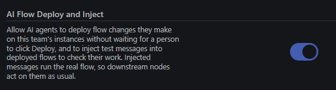

## Support for Vue SFC in Dashboard

<!--
https://github.com/flowfuse/nr-assistant/pull/426 
-->

With latest Node-RED (*2), dashboard (*3), and nr-assistant (*4) you now get a rich editor experience.
In `ui-template` nodes the editor understands Vue and Vuetify. Start typing a component, a prop, or `this.` and the editor suggests what fits.
See this [changelog](/changelog/2026/10/ui-template-code-editor) for more defails and a quick demo.

## Tidy flows
<!--
https://github.com/FlowFuse/nr-assistant/pull/433 flow layout alogrythm
https://github.com/flowfuse/nr-assistant/pull/434 flow layout editor actions and menu entry
-->

TODO: About this feature

{data-zoomable}
*example image.*

## Undo, Redo
<!--
https://github.com/flowfuse/nr-assistant/pull/438 undo/redo
https://github.com/flowfuse/nr-assistant/pull/440 undo/redo
-->

## Improved development cycle

<!--
https://github.com/flowfuse/nr-assistant/pull/441 add inject-message action
-->

FlowFuse expert and 3rd party agents now gets a new super power to help develop better flow.
A message can be injected directly into any node with an input and the AI can read the debug node output
allowing for an greatly improved development cycle. Simply enable **Flow Deploy and inject** on the team
settings page and let AI help you out.

{data-zoomable}
*Enabling deploy and inject.*

## Node-RED editor intelligence

We have updated the AI model behind the editor suggestions giving better context-aware completions. Editor suggestions now fit the code around your cursor. In function and `ui-template` nodes, a suggestion starts where your line stops and ends where your code carries on, without repeating brackets, tags or indentation that are already there. Ask for JSON in plain English and you get the data back indented, formatted and ready to use.

---

These features are available to all FlowFuse Cloud users and all Self-Hosted users from v3.2.

- _Vue SFC requires Node-RED v5.0.9 or greater - update your instance in the FlowFuse Instance Settings._
- _Vue SFC requires Dashboard v1.34.0 or greater - update your instance in the palette manager._
- _All features require `nr-assistant` v0.21.0 or greater - update your instance in the palette manager._
